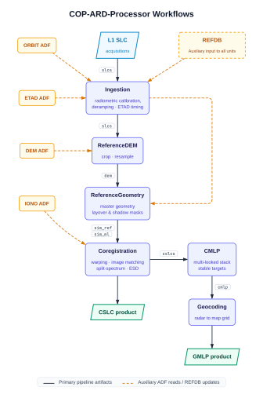

# 🛰️ ROSE-L-ARD

**Cloud-Native Analysis-Ready Data (ARD) Processor for Copernicus SAR Missions**

[](LICENSE)
[](https://python.org)
[](https://eopf.readthedocs.io/)
[](https://docs.astral.sh/uv/)
[](https://dask.org)
[](https://www.esa.int/)

<p align="center">
  <a href="#-processing-workflows">Workflows</a> •
  <a href="#-repositories">Repositories</a> •
  <a href="#-products">Products</a> •
  <a href="#-quickstart">Quickstart</a> •
  <a href="#-testing--verification">Testing</a> •
  <a href="#-consortium--contributors">Consortium</a>
</p>

---

A prototype processing pipeline for generating standardized **Analysis-Ready Data (ARD)** from Copernicus SAR missions (**Sentinel-1** and **ROSE-L**). 

The processor leverages **Xarray** and **Dask** for distributed, cloud-native high-throughput computation, adhering to the European Space Agency’s **EOPF** (Earth Observation Platform Framework) operational architecture.

---

## 🔄 Processing Workflows

The processor supports two execution pipelines:


1. **CSLC Pipeline (Coregistration Only):** Aligns images at sub-pixel accuracy to a reference geometry. The workflow completes directly after co-registration, providing full-resolution complex stacks optimized for phase-sensitive techniques (PSI, SBAS, DS).
2. **GMLP Pipeline (Coregistration + Multi-looking + Geocoding):** Ingests the co-registered data, compresses phase noise and volume via multi-looking into an intermediate radar-coordinate **CMLP** product, mitigates phase drifts, and geocodes the result into ready-to-use **GMLP**.

<p align="center">
  
</p>

* Auxiliary Data Files per unit: `Ingestion` applies the ETAD and ORBIT ADFs (exact timing and precise-orbit corrections), `ReferenceDEM` consumes the DEM ADF, and `Coregistration` optionally takes the IONO ADF for ionospheric correction.

---

## 📦 Repositories

The system is organized into three Python packages:

| Layer | Repository | Responsibilities |
| --- | --- | --- |
| **Operational** | [`cop-ard-processor`](https://github.com/ROSE-L-ARD/cop-ard-processor) | EOPF processing units (`ingestion`, `coregistration`, `geocoding`, `reference_dem`, `reference_geometry`, `reference_update`, `cmlp`), preflight validation, system verification tests, and Docker/Dask deployment targets. |
| **Application** | [`cop-ard-app`](https://github.com/ROSE-L-ARD/cop-ard-app) | Mission readers (Sentinel-1 SAFE, ROSE-L via [`sarpy`](https://github.com/ngageoint/sarpy)), coregistration workflow orchestration, interferogram generation, CMLP/GMLP pipeline assembling. |
| **Core** | [`cop-ard-core`](https://github.com/ROSE-L-ARD/cop-ard-core) | Low-level SAR numerical kernels: Orbit & geometry computation, image matching, ESD, split-spectrum processing, DEM handling, ionospheric estimation, and warping/resampling (NumPy / SciPy / Numba over Xarray/Dask). |

**Dependency flow:** `cop-ard-processor` → `cop-ard-app` → `cop-ard-core`

All packages require **Python 3.13** (`>=3.13, <3.14`) and are managed with [`uv`](https://docs.astral.sh/uv/) (`pyproject.toml` + pinned `uv.lock`).

---

## 🔬 Products

Image co-registration aligns multiple acquisitions so each pixel corresponds to the exact same ground target at sub-pixel accuracy.

* Fundamental baseline for multidimensional image stacks and multi-temporal SAR interferometry (PSI, SBAS, DS).
* Minimizes mission-specific geometric distortions across Sentinel-1, ROSE-L, and NISAR.
* Mitigates phase errors through integrated Enhanced Spectral Diversity (ESD) and Split-Spectrum ionospheric correction.

An ARD product optimized for large-scale interferometric monitoring, inspired by intermediate stages in PS/DS and SBAS processing chains before phase unwrapping.

* **Reduced Noise & Footprint:** Multi-looking suppresses speckle/phase noise and dramatically reduces data storage compared to full CSLC stacks.
* **Vegetation Drift Correction:** Incorporates correction methods to minimize long-term phase drifts caused by vegetative dynamics.
* **Continuous Ingestion:** Designed to support sequential updates as new acquisitions arrive.
* **Intermediate CMLP:** Generated first in radar coordinates on a subset of the original SLC grid (**CMLP**), then geocoded to standard map coordinates (**GMLP**).

---

## 🚀 Quickstart

The entry point for end users is the [`cop-ard-processor`](https://github.com/ROSE-L-ARD/cop-ard-processor) repository.

```bash
git clone https://github.com/ROSE-L-ARD/cop-ard-processor.git
cd cop-ard-processor
make install
```

`make install` is the **only supported installation path**. It downloads the **EGM2008 geoid grid** required for geoid-corrected vertical datums (`PROJ` / `pyproj`) and builds the local virtual environment. Running `uv sync` alone will bypass grid setup, causing geoid-dependent processing to fail at runtime.

---

## 🧪 Testing & Verification

### Unit & Integration Tests

Local test suites run with `pytest`:

```bash
uv run --extra tests pytest tests/
```

### System Verification Tests (SVT)

End-to-end SVTs (`tests/vt/`) validate full operational chains against S3 trigger data. Because of high storage and compute requirements, SVTs must be executed on a dedicated HPC environment (e.g., CEMPAL).

Test cases must run `REFERENCE.py` first to construct the reference baseline, followed chronologically by acquisition dates:

```bash
# Order enforced automatically; stages S3 trigger data
bash scripts/run_tests.sh TC-ST-FUNC-003

# Reuse existing reference database
bash scripts/run_tests.sh TC-ST-FUNC-009 --skip-reference
```

---

## 🛠️ Development & Deployment

* **Code Standards:** `make all` formats and runs `make check` (`ruff` lint, `bandit` security, `xenon` complexity, `mypy` typing).
* **Documentation:** `make html` renders `CSLC` and `GMLP` qualification Quarto notebooks into `docs/`.
* **Lockfile Management:** Refresh individual dependencies using `uv lock -P <package>` followed by `uv sync --extra tests`.
* **Containerization:** The included `Dockerfile` uses a multi-stage layout (a `uv` build phase + minimal `python:3.13-slim` runtime image containing the pinned environment and EGM2008 geoid assets).

---

## 🏛️ Consortium & Contributors

### Prime Contractor & Software Engineering

**[B-Open](https://bopen.eu)** is the project prime contractor, lead software developer, and long-term maintainer of the ROSE-L-ARD processing suite.

* **Federico Minati** ([@effeminati](https://github.com/effeminati)) — *Lead Developer*
* **Alessio Morea** ([@AlessioMorea](https://github.com/AlessioMorea))
* **Tommaso Carletti** ([@Sbyner](https://github.com/Sbyner))
* **Francesco Vecchioli** ([@francesco-vecchioli](https://github.com/francesco-vecchioli))

### Project Partners

* **Francesco DeZan** ([@fdz-insar](https://github.com/fdz-insar)) — [DeltaPhi](https://www.delta-phi.eu/)
* **Juan M. Lopez-Sanchez** ([@juanma-lopez](https://github.com/juanma-lopez)) — [University of Alicante](https://www.ua.es/en/)
* **Paco López-Dekker** ([@pakodekker](https://github.com/pakodekker)) — [TU Delft](https://www.tudelft.nl/en/)
* **Yan Yuan** ([@Yan-518](https://github.com/Yan-518)) — [TU Delft](https://www.tudelft.nl/en/)

---

## Acknowledgements

We gratefully acknowledge the support of the following organizations:

* **European Space Agency (ESA):** Funded under the *Prototype Processor for ARD of Copernicus SAR Missions* project.
* **CONAE & ASI:** Provided L-band SAOCOM SAR data used during prototype development, analysis, and validation activities.

---

## Sponsorship

[B-Open](https://bopen.eu) is committed to maintaining the project in the long term and welcomes sponsorships to support the development of new features and capabilities.

---

## License

```text
Copyright @ 2026 B-Open Solutions S.r.l.

Licensed under the Apache License, Version 2.0 (the "License");
you may not use this file except in compliance with the License.

You may obtain a copy of the License at

http://www.apache.org/licenses/LICENSE-2.0

Unless required by applicable law or agreed to in writing, software
distributed under the License is distributed on an "AS IS" BASIS,
WITHOUT WARRANTIES OR CONDITIONS OF ANY KIND, either express or implied.
See the License for the specific language governing permissions and
limitations under the License.
```

---

<div align="center">

#### Prime Contractor & Software Engineering
[](https://bopen.eu)

<br/>

#### Scientific & Consortium Partners
| [](https://www.delta-phi.eu/) | [](https://www.ua.es/en/) | [](https://www.tudelft.nl/en/) |
| :---: | :---: | :---: |

<br/>

#### Institutional Support & Data Providers
| [](https://www.esa.int/) | [](https://www.argentina.gob.ar/conae) | [](https://www.asi.it/) |
| :---: | :---: | :---: |

</div>
